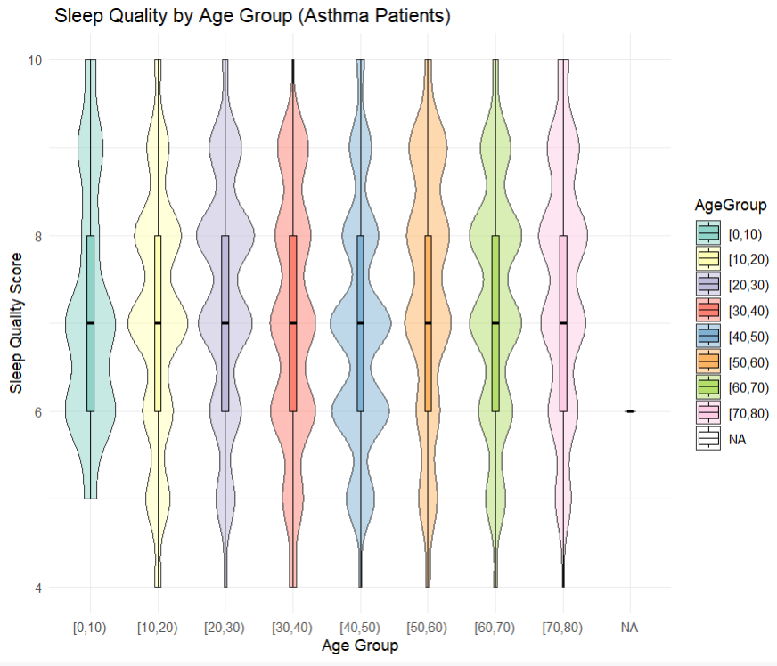
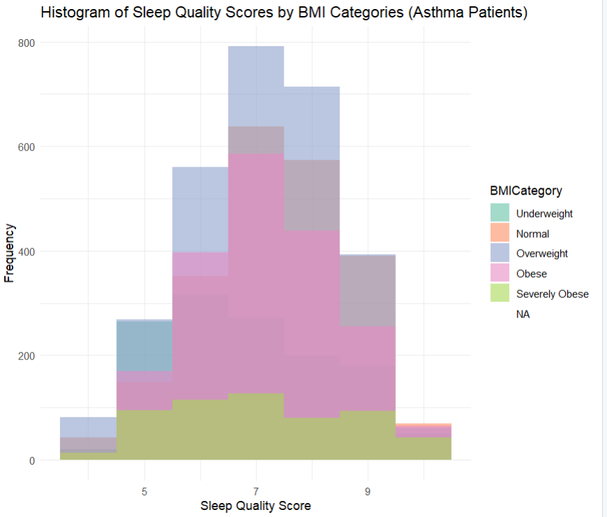
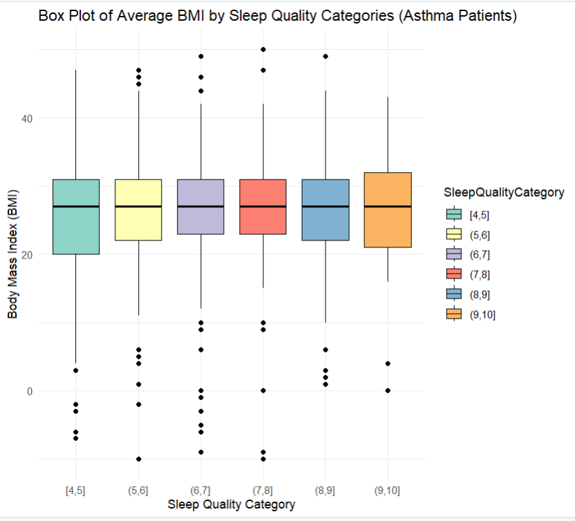
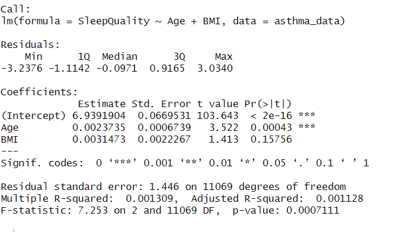

# Asthma Dataset Analysis in R: Age, BMI and Sleep Quality

Exploratory data analysis and statistical modelling of an asthma patient dataset (~11,000 records) in **R**, looking at how **age, BMI and sleep quality** relate in patients diagnosed with asthma.

> Programming for Data Analysis group project (4 members). The team shared the data cleaning, and each member answered their own research objective. This repository contains **my objective and analysis**, plus the shared cleaning script.

---

## Research Questions (my objective)
1. What is the impact of **age** on sleep quality in asthma patients? → violin + box plot
2. How do sleep quality scores differ across **BMI categories**? → overlaid histogram
3. How does average **BMI** vary across **sleep quality categories**? → box plot
4. **Extra feature**: a **linear regression** model, `SleepQuality ~ Age + BMI`

## Key Findings
- Younger adults (20–30) showed the widest spread and more low sleep-quality scores. Older patients (60–80) had higher and more consistent sleep quality.
- Underweight and Normal BMI groups clustered at mid-to-high sleep quality (6–8). Overweight and Obese groups varied more.
- BMI was fairly uniform across sleep-quality categories, so no strong direct relationship was found.
- Regression: **age is a statistically significant predictor** (p < 0.001) and **BMI is not** (p = 0.16). Overall R² is very low (0.001), which means other factors drive sleep quality.

| | |
|---|---|
|  |  |
|  |  |

## Files
| File | Description |
|---|---|
| `data_cleaning.R` | Shared pre-processing: NA handling, type conversion, outlier filtering, factor labels, median/mode imputation |
| `analysis.R` | My analysis: Q1–Q3 visualisations and the regression model |
| `correlation_breath_sleep.R` | Extra exploration: correlation between shortness of breath and sleep quality |

## Run
```r
install.packages(c("ggplot2", "dplyr", "tidyr", "reshape2"))
# put asthma_dataset.csv in data/
source("data_cleaning.R")
source("analysis.R")
```

## Tech Stack
R · ggplot2 · dplyr · tidyr · linear regression (`lm`)

## Author
**Sultan Mohammed Rabea** · [LinkedIn](https://www.linkedin.com/in/sultan-rabea/) · [GitHub](https://github.com/sultanrabea4)
